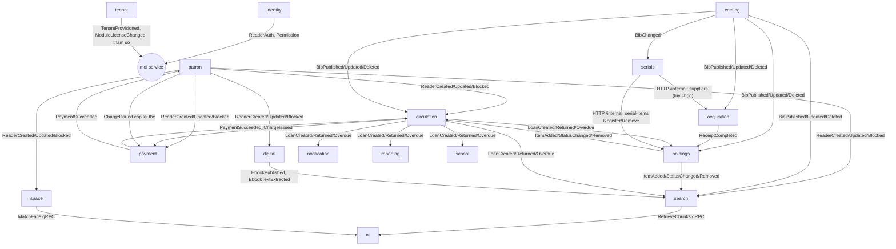

# 02 — Phân rã service

## 1. Nguyên tắc tách

1. **Mỗi bounded context là một service.** Mỗi service sở hữu duy nhất một database và là nguồn sự thật (source of truth) cho dữ liệu của mình. Service khác chỉ đọc qua API, event hoặc bản sao cục bộ.
2. **Ranh giới đi theo gói bán.** Không có service nào thuộc hai gói, để tắt một gói không làm hỏng gói khác.
3. **Dữ liệu cùng thay đổi trong một transaction thì ở cùng service.** Ví dụ: phiếu mượn, gia hạn và phiếu phạt cùng nằm trong `circulation`.
4. **Không tách quá mịn.** Các danh mục nhỏ (MARC, từ điển, trạng thái) đi theo service dùng chúng.
5. **Nhiều service có thể chạy chung pod ở profile nhỏ** ([06](06-nen-tang-k8s.md#2-profile-triển-khai)), nhưng **ranh giới DB không bao giờ gộp**.

## 2. Danh sách service

| Gói | Service | Trách nhiệm | Dữ liệu sở hữu (tiêu biểu) | Scale |
|---|---|---|---|---|
| **Nền tảng** (bắt buộc) | `identity` | Đăng nhập nhân viên/bạn đọc, OTP/captcha, phát token, vai trò, quyền, module, xác thực bạn đọc qua LDAP/API ngoài | Users, Roles, Permissions, Modules, GroupUsers | Thấp–vừa |
| | `tenant` | Đơn vị, tổ chức, tham số hệ thống, **license module**, khởi tạo đơn vị mới, danh mục tham chiếu chung | Tenants, Orgs, SystemParameters, Nations, Degrees… | Thấp |
| | `patron` | Hồ sơ bạn đọc, loại bạn đọc, nhóm, lớp/khoá, import, ảnh, thẻ, khoá thẻ | Readers, ReaderTypes, GroupReaders, Classes | Vừa |
| | `notification` | Gửi Email/SMS/Zalo ZNS theo template, nhật ký gửi, báo cáo định kỳ qua email | NotificationChannelConfigs, NotificationLogs, ScheduledReports | Theo hàng đợi |
| | `media` | Upload, presigned URL, ảnh bìa, xử lý ảnh, file server cũ | (metadata file) + MinIO | Vừa |
| | `audit` | Nhật ký thao tác, lịch sử thay đổi, log SIP2, giám sát tác vụ hàng loạt (AdminTask) | UserLogs, Sip2Logs, AdminTasks* | Theo hàng đợi |
| **Sách in** | `catalog` | Biên mục MARC21/AACR2/ISBD, worksheet, từ điển (tác giả, phân loại, từ khoá, NXB…), nhật ký biên mục | Bibs, BibXmls, Marc*, Dic*, Worksheet* | Vừa |
| | `holdings` | Bản sách (đăng ký cá biệt), kho, giao nhận, chuyển kho, kiểm kê, thanh lý, mất sách, xuất kho, thống kê kho (tủ/ngăn gửi đồ thuộc `space`) | Barcodes, Stores, Inventories, Thanhlys, AbMoves | Vừa |
| | `circulation` | Mượn/trả/gia hạn, đặt mượn, chính sách lưu thông, điểm lưu thông, **tính phạt**, sao chụp, SIP2 | BookOuts, BookIns, PolicyCircs, CFineTickets, CPhotos | **Cao** (giờ cao điểm) |
| | `acquisition` | Đơn đặt, phiếu nhận, nguồn, nhà cung cấp, ngân sách, quỹ, báo cáo bổ sung | AbOrders, AbReceipts, Budgets, Funds, Suppliers | Thấp |
| | `serials` | Ấn phẩm định kỳ: kỳ phát hành, mẫu, đăng ký, đóng tập | Serials, SerialItems, PatternMagazines | Thấp |
| **Thư viện số** | `digital` | Tài liệu số, bộ sưu tập, file, metadata schema, chính sách truy cập, mượn/đặt trước số, trang đọc, theo dõi đọc, đánh giá, nộp tài liệu. Có worker `digital-indexer` (Python): trích xuất text/OCR | EbookItems, EbookFiles, PolicyDigitals, EbookItemLoans | **Cao** (trang đọc) |
| **Tra cứu** | `search` | Read model Elasticsearch (sách in, ebook, chunk nội dung + vector), tìm kiếm hợp nhất, failover, Z39.50 (Zebra server + client), không gian nghiên cứu, tìm kiếm đã lưu | SearchObservations, ReaderWorkspaces, Z3950Configs + chỉ mục ES | **Cao** |
| **Mở rộng** (tuỳ chọn) | `payment` | Thu phí qua VietQR/VNPAY/Sepay (phạt, sao chụp, cấp lại thẻ…), đối soát, hết hạn giao dịch | PaymentTransactions | Thấp |
| | `space` | Sơ đồ thư viện, phòng học nhóm, đặt phòng, check-in (gồm khuôn mặt), kiểm soát ra vào, quầy tiếp đón, chìa khoá tủ | Map*, RoomBookings, Access*, KeyIns/KeyOuts | Vừa |
| | `ai` | Hỏi đáp RAG (SSE), trợ lý tìm tài liệu, phân tích ảnh bìa, nhận diện khuôn mặt, chất lượng tìm kiếm, thống kê chat | Cache hội thoại, thống kê (DB riêng) | **Cao**, cô lập |
| | `portal` | CMS: tin tức, sự kiện, banner, menu, trang, album, video, liên kết, bộ đếm truy cập | News, Banners, Menus, Pages… | Vừa (OPAC) |
| | `reporting` | Dashboard, báo cáo tổng hợp liên phân hệ, kiểm tra chất lượng dữ liệu, trung tâm công việc | Read model từ event (DB riêng) | Thấp |
| **K12** | `school` | Chương trình đào tạo (Evaluate), EOffice (công văn), Gamification (huy hiệu) | EvaluatePrograms, MonHocs, Documents (eoffice), Badges | Thấp |

Ngoài ra còn **`gateway`** (YARP), không có dữ liệu nghiệp vụ. Gateway làm hai việc: định tuyến, và ghép dữ liệu cho một số màn hình OPAC (BFF), ví dụ `MyLibrary` ([03 §2](03-giao-tiep.md#2-gateway--bff)).

### Context map

## 3. Quyết định sở hữu cho các điểm coupling

| Dữ liệu dùng chéo | Chủ sở hữu | Cách service khác dùng |
|---|---|---|
| Bạn đọc (`Readers`) | `patron` | `circulation`/`digital`/`space`/`payment` giữ `PatronReplica` (id, mã thẻ, họ tên, loại, lớp, trạng thái khoá, hạn thẻ), cập nhật bằng event |
| Ảnh bạn đọc | `patron` (file ở `media`) | `ai` nhận URL presigned khi so khớp khuôn mặt |
| Biểu ghi (`Bibs`, `BibXmls`) | `catalog` | Service khác chỉ giữ **snapshot hiển thị** (nhan đề, tác giả, ký hiệu phân loại, ảnh bìa), cập nhật qua `BibUpdated` |
| Bản sách (`Barcodes`) | `holdings` (vị trí, trạng thái vật lý: sẵn sàng / mất / thanh lý / đang xử lý) | `circulation` giữ `ItemReplica`. **Trạng thái "đang mượn" do `circulation` sở hữu**, không ghi ngược vào holdings. Holdings chỉ nhận event để hiển thị |
| Phạt / phí | `circulation` (phạt, sao chụp), `patron` (cấp lại thẻ) phát `ChargeIssued` | `payment` thu tiền; `PaymentSucceeded` báo ngược để đánh dấu đã nộp |
| Người dùng nhân viên (`Users`) | `identity` | Service khác chỉ lưu `UserId` + tên snapshot trong nhật ký |
| Đơn vị / tổ chức (`Tenants`, `Orgs`) | `tenant` | Mỗi service giữ bảng `TenantReplica` (id, mã, trạng thái, module được bán) |
| Từ điển MARC dùng cho OPAC | `catalog` | `search` index sẵn nhãn hiển thị |

## 4. Gom service khi triển khai nhỏ

Với profile "cụm theo tỉnh" ([06](06-nen-tang-k8s.md#2-profile-triển-khai)), các service tải thấp được build thành image riêng nhưng có thể chạy chung một **host process**. Mỗi service vẫn dùng connection string và database riêng. Các nhóm gộp:

- `platform-host`: `tenant`, `notification`, `audit`, `media`
- `backoffice-host`: `acquisition`, `serials`, `school`, `reporting`

Cách làm: mỗi service là một assembly đăng ký qua `AddXxxService()`. Host gộp gọi nhiều `AddXxxService()` liền nhau. Ở profile SaaS, mỗi service chạy host riêng.

---

## Phụ lục A — Ánh xạ controller

Đây là checklist parity: 306 controller nghiệp vụ của monolith (không tính `BaseApi`, `Generic`, `PublicBase`), mỗi controller xuất hiện đúng **một** lần. Tên viết không có hậu tố `Controller`. Thư mục gốc là `ELIBAPI.API/Controllers/`.

| Service | Controller |
|---|---|
| `identity` | `Auth`, `Users`, `GroupUser`, `Roles`, `Permission`, `Module`, `ModuleRoles`, `ReaderAuthTest`, `ReaderTrackingLogin`, `AdminPreference`, `PbRoles`, `PbPrivate` |
| `tenant` | `Tenant`, `Org`, `SystemParameter`, `SystemPara`, `SystemInfo`, `SystemDescription`, `Currency`, `Nation`, `Ethenic`, `Prof`, `Degree`, `ChucVu`, `PhongBan`, `PublicTenant`, `PublicSystemParameter` |
| `patron` | `Reader`, `ReaderType`, `GroupReader`, `ReaderInGroup`, `ReaderDelete`, `ConfigImportReader`, `Class`, `Course`, `PublicReader` |
| `notification` | `NotificationChannelConfig`, `NotificationLog`, `ScheduledReport` |
| `audit` | `UserLog`, `EntityHistory`, `Sip2Log`, `AdminJob`, `AdminTask`, `AdminTaskMonitor`, `AdminTaskRetention` |
| `catalog` | `Aacr2Field`, `Aacr2Subfield`, `Bib`, `BibData`, `BibType`, `BibWorksheet`, `BibXml`, `BookGroup`, `BookGroupDetail`, `CatalogueBibType`, `CatalogueBook`, `CatalogueClassLabel`, `CatalogueDicClass`, `CatalogueWorkSheet`, `ConfigAacr2`, `ConfigIsbd`, `DBibStatus`, `DFixField`, `DFixFieldPost`, `DFixFieldValue`, `DPublisher`, `DicAuthor`, `DicClass`, `DicCountries`, `DicGeographicAreas`, `DicKeyword`, `DicLanguage`, `DicPublisher`, `DocGroup`, `FixedFieldValue`, `IsbdField`, `IsbdSubfield`, `LinhVucNghienCuu`, `LogBienMuc`, `MarcBibLevel`, `MarcCodeList`, `MarcConvert`, `MarcField`, `MarcIndicator`, `MarcRecordType`, `MarcSubField`, `MarcType`, `MaterialsType`, `PrintBookAndDigital`, `RecordType`, `WorksheetField`, `WorksheetSubfield` |
| `holdings` | `Barcode`, `BarcodeStatus`, `Cabinet`, `CabinetCompartment`, `Inventory`, `InventoryBarcode`, `KiemKe`, `LostBook`, `Thanhly`, `Store`, `StoreType`, `StoreInventory`, `StoreLiquidate`, `StoreLostBook`, `StoreMapShelving`, `StoreReRegisterBarcode`, `StoreShelving`, `StoreStatistics`, `StoreBookReport`, `BookOutStore`, `AbDeliverer`, `AbDelivererDetail`, `AbDelivererStatus`, `AbMove`, `AbMoveDetail`, `CatalogueDeliverer`, `CatalogueMove`, `DExportReason`, `DExhibitionLocation`, `DBookOutUnit` |
| `circulation` | `BookIn`, `BookOut`, `CFine`, `CFineMethod`, `CFineType`, `CFineTicket`, `CPhoto`, `CQueueStatus`, `CRenew`, `CRenewData`, `CircPlace`, `CirculationCircPolicy`, `CirculationFine`, `CirculationHistory`, `CirculationLoan`, `CirculationReport`, `CirculationRequest`, `PolicyCirc`, `PolicyCircDocGroup`, `PolicyCircFine`, `Lydophat`, `BookRequest` |
| `acquisition` | `AbOrder`, `AbOrderDetail`, `AbReceipt`, `AbReceiptDetail`, `AbSource`, `AhReceipt`, `AcquisitionReport`, `BibDataOrder`, `BibOrder`, `BibXmlOrder`, `Budget`, `Fund`, `OrderStatus`, `ReceiptStatus`, `Supplier`, `CatalogueBookOrder`, `CatalogueOrder`, `CatalogueReceipt` |
| `serials` | `Serial`, `SerialItem`, `FrequencyMagazine`, `MagazineBinding`, `MagazineFrequency`, `MagazineMagazineType`, `MagazinePattern`, `MagazineReport`, `MagazineSerial`, `MagazineType`, `PartemMagazineDetail`, `PatternMagazine`, `SubcriptionStatus` |
| `digital` | `CollectionPermistionUser`, `DigType`, `EbookAccess`, `EbookCollection`, `EbookFile`, `EbookItem`, `EbookItemLoan`, `EbookItemReservation`, `EbookItemXml`, `EbookLog`, `EbookReview`, `EbookSubject`, `EbookTopic`, `IntroBookCategory`, `IntroBooks`, `MetaDataFieldRegistery`, `MetaDataValue`, `MetadataSchemaRegistry`, `PolicyDigital`, `PolicyDigitalByCollection`, `ReadingTracking`, `TheodoiBienmucEbook`, `DocumentSubmission`, `PublicDigType`, `PublicEbook`, `PublicEbookCollection`, `PublicEbookFavorite`, `PublicEbookReview`, `PublicEbookSubject`, `PublicEbookTopic` |
| `search` | `Book`, `PublicUnifiedSearch`, `PublicPrintBook`, `PublicEbookSearch`, `PublicSearchZ3950`, `PublicZ3950Config`, `OpacZ3950`, `OpacZ3950Config`, `Z3950Group`, `ReaderWorkspace` |
| `payment` | `Payment`, `PaymentReader`, `PaymentWebhook` |
| `space` | `AccessControl`, `AccessDevice`, `MapBuilding`, `MapEquipment`, `MapFloor`, `MapFloorUtility`, `MapObject`, `MapShelfDetail`, `MapShelfRow`, `PublicLibraryMap`, `RoomBooking`, `RoomBookingAdmin`, `RoomBookingConfig`, `CheckIn`, `CheckOut`, `KeyIn`, `KeyOut`, `PbKey`, `DKey`, `ConfigReceiption`, `ReceiptionBorrowKey`, `ReceiptionCheck`, `ReceiptionReport`, `ReceiptionStatistics`, `TrackingToLibrary` |
| `ai` | `PublicChat`, `AdminStatChat`, `SearchQuality`, `FaceRecognition` |
| `portal` | `Ads`, `AdsGroup`, `AttachFile`, `Banner`, `Category`, `CmsItem`, `Contact`, `ContactGroup`, `Counter`, `Customer`, `EventNews`, `ItemType`, `Link`, `LinkGroup`, `Media`, `Menu`, `MenuType`, `News`, `NewsComment`, `Page`, `Photo`, `PhotoAlbum`, `Video`, `PublicBanner`, `PublicCategory`, `PublicCounter`, `PublicHomeBanner`, `PublicHyperLink`, `PublicMedia`, `PublicMenu`, `PublicNews`, `PublicPhoto`, `PublicPhotoAlbum` |
| `reporting` | `Dashboard`, `DashboardLibrary`, `PublicStatistic`, `DataQuality`, `WorkCenter`, `DocumentUnitReport` |
| `school` | `Agency`, `Document`, `DocumentFile`, `DocumentType`, `EofficeTopic`, `CourseOption`, `DonVi`, `EvaluateCourse`, `EvaluateDegree`, `EvaluateProgram`, `Knowledge`, `MonHoc`, `NganhHoc`, `NganhHocReport`, `NganhMonHoc`, `SubjectTree`, `TaiLieu`, `Badge` |
| `gateway` (BFF) | `MyLibrary` |

Ghi chú:
- **Gateway BFF `MyLibrary`**: GĐ1 OPAC gọi thẳng `circulation` qua route `circulation-reader` (`/api/opac/circulation/**`) — chưa cần ghép ở gateway vì chỉ có một service đứng sau. BFF thật (composition, trả từng phần khi một service lỗi) dùng từ GĐ2 khi MyLibrary ghép thêm phí (`payment`), ebook (`digital`), đặt phòng (`space`).
- **`media` không có controller riêng.** Endpoint upload hiện nằm rải rác (`AttachFile`, `EbookFile`, `Media`…). Khi viết lại, phần upload và presigned URL chuyển sang `media`; phần metadata vẫn thuộc service nghiệp vụ.
- **Báo cáo chỉ thuộc một phân hệ thì ở lại service đó** (`CirculationReport`, `AcquisitionReport`, `MagazineReport`, `StoreBookReport`, `ReceiptionReport`). `reporting` chỉ giữ báo cáo liên phân hệ.
- **`Book`** (gọi Elasticsearch) chuyển sang `search`. Phần ghi biểu ghi sách thuộc `catalog`.

### Tiến độ port

| Controller | Trạng thái | Ghi chú |
|---|---|---|
| tenant: `Tenant` | ✅ | `/api/system/tenant/tenants` — chỉ quản trị nền tảng, thêm license và saga khởi tạo |
| tenant: `SystemParameter`, `Currency`, `Nation`, `Ethenic`, `Prof`, `Degree`, `ChucVu` | ✅ | `Crud` building block, cùng 8 endpoint và mã quyền. Đổi tên tài nguyên: `nationalities`, `ethnicities`, `academic-titles` (Prof = học hàm học vị), `degrees` (trình độ), `positions`, `currencies`, `system-parameters` |
| tenant: `Org` | ✅ | Thêm `GetTree`, `UpdateOrder`, `Move`, `DeleteWithChildren`; chặn chuyển vào nhánh con, `Delete` thường chặn khi còn con |
| tenant: `PublicSystemParameter` | ✅ | `/api/opac/tenant/parameters` — **chỉ trả tham số công khai** (monolith trả mọi mã, kể cả `READER_AUTH_CONFIG`) |
| tenant: `PublicTenant` | ✅ | `ResolveByHost` do gateway + `/api/opac/tenant/features` (có `logoUrl`, `logoText`); `Manifest.json` → `/api/opac/tenant/manifest.json` (icon `sizes: any`, monolith khai 192/512 cho cùng một ảnh). `Search`/`SearchAll` (danh sách đơn vị công khai) chưa port — chờ OPAC liên trường |
| tenant: (mới) nhận diện đơn vị | ✅ | `PUT /api/system/tenant/tenants/{id}/branding`: logo chỉ nhận file media của chính đơn vị (`/s3/media-public/{id}/tenant-logo/…`), không nhận URL ngoài; nhật ký `TENANT_BRANDING` |
| tenant: `SystemPara`, `SystemInfo`, `SystemDescription`, `PhongBan` | ⛔ Không port | Không có mã nghiệp vụ hay màn hình nào dùng — chỉ còn controller CRUD |
| tenant: `Import` Excel (Org, Nation, Ethenic, Prof, Degree, ChucVu) | ✅ | Chung trong `Crud` (`ICrudImportable`): `GET …/ImportTemplate` (file mẫu .xlsx) + `POST …/Import` (multipart, `?skipDuplicates=true`). Mỗi dòng đi đúng đường Thêm mới trong **một transaction**: có dòng lỗi thì không ghi dòng nào, trả lỗi theo số dòng (monolith ghi phần hợp lệ, không báo dòng nào lỗi). Nhận tiêu đề cũ "Name"; chỉ .xlsx, ≤ 5 MB, ≤ 5.000 dòng; một dòng nhật ký `IMPORT` |
| (mới) OPAC | 🟡 Một phần | App `opac` ở gốc host đơn vị: trang chủ theo tham số công khai + phân hệ đã mua, logo, manifest; **tra cứu** `/tim-kiem` (điều kiện trên URL, tìm nâng cao, facet, gợi ý khi gõ, phân trang, ảnh bìa, **lưu tìm kiếm** trên trình duyệt kèm số kết quả mới từ lần xem trước — monolith `ReaderSavedSearch` lưu theo tài khoản bạn đọc, sẽ chuyển lên server khi có đăng nhập bạn đọc) và **chi tiết** `/tai-lieu/{publicId}` (ảnh bìa, thông tin mô tả, tab ISBD và MARC, tải biểu ghi `.mrc`/MARCXML, bản sách và tình trạng, tài liệu liên quan); quá giới hạn lượt tra cứu (429) hiện "vui lòng chờ N giây"; **đăng nhập bạn đọc** (PKCE với identity, token trong sessionStorage — máy dùng chung ở thư viện, đóng tab là hết phiên), trang `/tai-khoan` (thông tin thẻ, đổi mật khẩu, đăng xuất, thẻ điện tử). **MyLibrary sách in** (xong): sách đang mượn kèm hạn trả + gia hạn, lịch sử mượn, đặt mượn/huỷ đặt mượn (từ trang chi tiết tài liệu hoặc `/tai-khoan`) — gọi thẳng `circulation` qua `/api/opac/circulation/**` (`ReaderCirculationEndpoints`, tự suy ra bạn đọc từ token, không nhận số thẻ từ client); trang tài khoản hiện cảnh báo không mượn được (thẻ khoá/hết hạn/đang quá hạn) và số tiền phạt còn nợ. ⏳ còn: thư viện số (`thu-vien-so` vẫn "đang xây dựng", chờ `digital`), lưu tìm kiếm chuyển lên server theo tài khoản (hiện chỉ lưu trình duyệt) |
| tenant: (mới) `resync` | ✅ | `POST /api/system/tenant/tenants/{id}/resync` phát lại `TenantUpdated` + `ModuleLicenseChanged` để service thêm sau dựng bản sao đơn vị |
| (mới) tự dựng bản sao đơn vị | ✅ | Service khởi động với bản sao đơn vị **trống** (vừa triển khai vào hệ đang chạy) tự gọi `GET /internal/tenants/replicas` (service token), ghi bản sao theo cùng quy tắc `SourceVersion`, rồi chạy seeder cho đơn vị đang hoạt động. Bật bằng `TenantReplica:TenantUrl` (building block `TenantReplica`) |
| notification: kênh email (`NotificationChannelConfig`) | ✅ | `/api/admin/notification/email-settings`: SMTP riêng của đơn vị (mật khẩu mã hoá Data Protection, không trả về API), không có thì dùng SMTP nền tảng; chặn SMTP trỏ vào mạng nội bộ; gửi thử theo mẫu `TEST_EMAIL` |
| notification: mẫu email | ✅ | `email-templates` (`Crud`, quyền `NOTIFICATION_TEMPLATES`); mẫu mặc định `TEST_EMAIL`, `LOGIN_OTP` seed khi khởi tạo đơn vị, đơn vị chưa có mẫu thì dùng mẫu mặc định; biến `{{ ten_bien }}` được mã hoá HTML |
| notification: `NotificationLog` | ✅ | `notification-logs/Search` chỉ đọc; **không lưu nội dung thư** (có thể chứa OTP); chống gửi trùng theo `DeduplicationKey` |
| notification: consumer `NotificationRequested` | ✅ | Chỉ kênh email; lỗi SMTP ghi nhật ký, không retry (tránh gửi trùng thư đã tới nơi) |
| payment: `PaymentTransaction`, `PaymentExpiryJob`, `PaymentWebhook` | ✅ | Service `payment` (DB `elib_payment`, license `PAYMENT`): tài khoản nhận tiền theo đơn vị `payment-account` (VietQR + khoá Sepay; VNPAY TmnCode + HashSecret — bí mật mã hoá Data Protection, không trả về API), khoản thu `charges` do `circulation` (phiếu phạt, sao chụp) / `patron` (phí cấp lại thẻ `card-fees`) phát qua `ChargeIssued/Waived/Settled` (khoá theo nguồn + version; `LastPaymentCode` để event cũ không mở lại khoản đã thu) và **dựng lại từ dữ liệu có sẵn** qua `/internal/tenants/{id}/charges/open` (phiếu lập trước khi dùng thanh toán). Sinh mã: VietQR (chuỗi EMVCo + CRC16, đúng bố cục monolith) hoặc URL VNPAY ký HMAC-SHA512; số tiền luôn lấy từ nguồn. Webhook công khai trên host từng thư viện: `/hooks/vnpay/ipn` (kiểm chữ ký, **kiểm số tiền**, 02 khi gửi lại, 04 sai số tiền), `/hooks/sepay` (khoá so sánh hằng thời gian, khớp mã trong nội dung + số tiền); `WebhookLog` giữ 90 ngày. Hết hạn: `PaymentExpiryJob` mỗi phút → `PaymentExpired`; **tiền về sau khi hết hạn → `PaidLate` + cần đối soát (không mất dấu)**; khoản đã thu cách khác → chỉ ghi nhận + 'cần hoàn tiền', không báo nguồn ghi lần hai; hai webhook cùng lúc chỉ một thắng (trạng thái là concurrency token). `PaymentSucceeded` → circulation ghi khoản QR vào sổ phạt (khoá chống trùng `ExternalRef`), thu dư so với còn nợ thì lập đề xuất hoàn chờ duyệt; sao chụp → đã thu; patron → phí đã thu. OPAC tab 'Phí / Nợ của tôi'; admin: dialog QR (phiếu phạt, sao chụp, phí cấp lại thẻ), màn giao dịch & đối soát, tài khoản nhận tiền (kèm URL webhook để dán vào Sepay/VNPAY). ⏳ còn: kiểm với tài khoản sandbox VNPAY/Sepay thật; hoàn tiền qua cổng (hiện hoàn thủ công + ghi 'đã xử lý'); SMS/Zalo nhắc nợ |
| digital (tiếp): `ReadingTracking`, `MetaDataFieldRegistery`, `MetadataSchemaRegistry`, `MetaDataValue`, `EbookReview`, `EbookAccess` | ✅ | **Duyệt đánh giá**: `reviews/{id}/Approve|Reject` (quyền `DIGITAL_REVIEWS:approve`; từ chối có lý do; báo người gửi qua email nếu có; ô bẫy chống bot, trần số đánh giá chờ duyệt theo tài liệu/email); `ChangeStatus` chung của CRUD bị chặn để không vòng qua quyền approve. **Schema metadata**: `metadata-schemas` / `metadata-fields` (quyền `DIGITAL_METADATA`; Field/Subfield, mô tả vi/en, kiểu nhập text/textarea/date/number) + `items/{id}/metadata` (đặt cả danh sách, kiểm theo kiểu nhập, trường ẩn giữ dữ liệu cũ). **Theo dõi đọc** (quyền `DIGITAL_READING`): trình đọc gửi nhịp `PUT /api/reader/reading/progress` (thời gian đọc bị chặn theo đồng hồ server, không tin số máy khách), tiến độ 'đọc tiếp', dấu trang, nhật ký xem/tải; admin thống kê theo ngày/sách/bạn đọc; nhật ký quá 730 ngày bị dọn trong job hằng giờ. **Trang đọc OPAC**: pdf.js nạp lười (cả file qua URL ký, hết hạn URL không ngắt việc đọc), nhớ trang, dấu trang, watermark theo bạn đọc — chặn tải/in chỉ là cản trở giao diện, KHÔNG phải DRM. Event `EbookChanged` (một event trạng thái thay cho Published/Updated/Unpublished — xem 03). **Quản lý tài liệu số như LRC** (màn Tài liệu số): trường giàu (tác giả/người hướng dẫn họ-tên, số định danh ISSN/ISMN/ISBN/URI, tóm tắt, mô tả, tên tạp chí, ngày-tháng-năm xuất bản; dữ liệu cũ được backfill từ chuỗi phẳng), bộ lọc nâng cao (tác giả, NXB, nhan đề, khoảng năm, ngày nộp theo ngày VN, miễn phí), chọn nhiều/cả kết quả lọc để chuyển bộ sưu tập · đổi trạng thái · xoá (bỏ qua tài liệu còn file và nêu lý do), xuất Excel (chọn cột) + metadata Dublin Core ZIP, nhập Excel và Dublin Core XML (từng dòng độc lập, báo lỗi theo dòng; XML cấm DTD), màn Quản lý File (thêm/sửa/xoá), ảnh bìa từ trang PDF (vẽ bằng pdf.js ở trình duyệt, `PUT items/{id}/cover`), phân quyền bộ sưu tập theo loại bạn đọc (`collections/{id}/permissions`). **Tích hợp thêm**: tra ISBN (Google Books → Open Library bổ sung trường thiếu, nhớ tạm 24 giờ; `items/LookupIsbn`); gợi ý phân loại bằng Gemini (`items/SuggestClassification` — chọn chủ đề/nhóm ngành trong danh mục của đơn vị + từ khóa; TẮT khi chưa có `Digital__Ai__ApiKey`); **đồng bộ nội dung** (`items/SyncContent` → hàng đợi trong bảng `ebook_content_states`, việc nền `EbookContentSyncJob` đọc PDF từ media qua luồng nội bộ, PdfPig trích lớp chữ, cắt đoạn ~1.200 ký tự theo trang vào `ebook_chunks`, vector hóa bằng Ollama nếu có `Digital__Ollama__BaseUrl`; PDF quét không có chữ báo `no_text` — chưa có OCR) và **tìm trong nội dung** (OPAC `content/search`: từ khóa, đoạn trích chỉ cho tài liệu công khai; cán bộ `items/SearchContent` thêm tìm theo ngữ nghĩa bằng cosine tính trong ứng dụng, tối đa 20.000 đoạn — chưa có pgvector nên chưa dùng cho kho lớn); **gói DSpace Simple Archive**: nhập ZIP (`items/ImportDspace`, chặn đường dẫn thoát thư mục, trần số mục / dung lượng giải nén, chỉ nhận PDF) và xuất kèm file (`items/ExportWithFiles`, ZIP dựng ra tệp tạm, file đi qua luồng media `/internal/.../ebook-files/{id}/content`, trần 200 tài liệu / 1.000 file / 2 GB). ⏳ còn: OCR cho PDF quét, chỉ mục vector (pgvector), giao diện tìm ngữ nghĩa, `EbookRead` cho reporting, `CollectionPermistionUser`, `DigitalStorageAuditJob` |
| portal: `News`, `Category`, `EventNews`, `AttachFile`, `NewsComment`, `Page`, `Menu`, `MenuType`, `Banner`, `ADS`, `ADSGroup`, `Link`, `LinkGroup`, `Photo`, `PhotoAlbum`, `Video`, `Contact`, `ContactGroup`, `Counter` | ✅ | Service `portal` (DB `elib_portal`, license `PORTAL`): CMS cho OPAC. Tin tức (slug duy nhất, hẹn giờ đăng/gỡ, nổi bật, tìm không dấu, tệp đính kèm, bình luận chờ duyệt), chuyên mục cây, sự kiện, trang tĩnh, menu cây theo loại (đích chỉ http(s) / đường dẫn nội bộ / trang hoặc chuyên mục của đúng đơn vị), banner & quảng cáo (khoảng ngày hiển thị), liên kết, album ảnh, video (chỉ nhúng YouTube/Vimeo theo mã), liên hệ ẩn danh (ô bẫy, trần số liên hệ mới, thư báo tới email nhóm), bộ đếm theo ngày (không lưu IP). **HTML do CMS soạn luôn được làm sạch ở server** (danh sách trắng thẻ/thuộc tính; ảnh chỉ nhận ảnh đã upload của chính đơn vị) và Angular lọc lại khi hiển thị. Đăng/gỡ/sửa nội dung đã đăng cần quyền `publish` (`PORTAL_NEWS`, `PORTAL_PAGES`). Ảnh/tệp: media purposes `cms-image`, `cms-attachment` (công khai) + thư viện ảnh `GET /api/admin/media/files?purpose=`. OPAC: trang chủ (banner, tin mới, quảng cáo, liên kết), `/tin-tuc`, `/trang/{mã}`, `/lien-he`, `/hinh-anh-video`, menu động đầu/chân trang, bộ đếm. ⏸ `Customer`/`CmsItem`/`ItemType` (LRC chỉ có controller rỗng, không màn hình nào dùng). Chuyên mục yêu cầu đăng nhập: ẩn với khách, bạn đọc đã đăng nhập xem qua đường riêng `/api/opac/portal/member/**` (gateway chỉ nhận token bạn đọc); đếm lượt nhấp quảng cáo (`Ads.Clicks`, chỉ quảng cáo đang hiển thị); màn admin Bộ đếm truy cập (`PORTAL_COUNTER`). ⏳ còn: sự kiện `NewsPublished` cho search/notification |
| notification: SMS, Zalo ZNS, `ScheduledReport` | ⏳ | GĐ2 (cùng `reporting`) |
| identity: `Module`, `ModuleRoles`, `Permission` | ✅ | Danh mục quyền trong code (`PermissionCatalog`, lọc theo license) thay bảng `Module`; quyền gán cho **vai trò** (monolith gán cả theo người dùng — bỏ). `GET /api/admin/identity/permission-catalog`; lưu vai trò kiểm tra mã quyền có trong danh mục; vai trò quản trị mặc định khoá tên + "*" |
| identity: CAPTCHA đăng nhập | ✅ | Tham số `ADMIN_LOGIN_CAPTCHA_ENABLED` của đơn vị (identity đọc từ tenant, cache 5 phút, xoá qua `SystemParameterChanged`); ảnh **PNG** tự vẽ (monolith dùng SVG `<text>` — máy đọc thẳng được đáp án) |
| identity: OTP đăng nhập | ✅ | `ADMIN_LOGIN_OTP_ENABLED`; mã 6 số qua `NotificationRequested` (sysadmin: `SystemNotificationRequested`, bật bằng `Identity:SystemLogin:OtpEnabled`); tài khoản không có email thì không áp dụng |
| identity: (mới) đóng vai đơn vị | ✅ | `POST /api/system/identity/impersonation` → vé 60 giây dùng một lần → `/account/impersonate` trên host đơn vị → token `imp=readonly` 30 phút; chỉ quyền `:view`; phát `AuditRecorded` (thay "thấy gộp mọi đơn vị" của `ReadOnlyPolicy`) |
| identity: bạn đọc (`Reader*`, đăng nhập LDAP/API) | ✅ | **Mật khẩu bạn đọc** ở identity (bảng `reader_accounts`, RLS), không ở patron: hồ sơ (số thẻ, họ tên, email, trạng thái, hạn thẻ) là bản sao từ `ReaderChanged` theo Version; bạn đọc chưa có bản sao (vừa tạo, hoặc tạo trước khi identity nhận event) thì identity hỏi patron `GET /internal/tenants/{id}/readers/{publicId}`. `/api/admin/identity/reader-accounts`: `Status` (tình trạng theo danh sách bạn đọc — không trả mật khẩu/chuỗi băm, quyền `READERS:view`), `{id}/password`, `BulkPassword` (≤ 2.000 bạn đọc), `{id}/unlock` (quyền `READERS:edit` như `Reader/ResetPassword`, `BulkResetPassword` của monolith). Hai cách: mật khẩu đặt tay (BCrypt cost 12, từ 6 ký tự như monolith; hàng loạt dùng một chuỗi băm cho cả lượt) hoặc **mật khẩu = số thẻ** (không băm — đặt cho cả trường trong một lượt, so không phân biệt hoa/thường, số thẻ đổi thì đổi theo); cả hai luôn bắt đổi ở lần đăng nhập đầu. Nhật ký `READER_PASSWORD`, `READER_PASSWORD_BULK`, `READER_ACCOUNT_UNLOCK` (không ghi mật khẩu). Monolith nhận mật khẩu cả ở form thêm/sửa và cột Excel — hệ mới tách ra thao tác riêng để mật khẩu không đi qua patron/event. **Đăng nhập OPAC** (thay `PublicReader/Login` + `ReaderAuthService` nhánh nội bộ): Authorization Code + PKCE, client `elib-opac`, chỉ trên host của đơn vị; trang `/account/reader-login` của identity (số thẻ không phân biệt hoa/thường, hoặc email nếu chỉ một bạn đọc dùng), cookie phiên **riêng** với nhân viên (`elib.identity.reader`) — phiên bạn đọc không mở được app quản trị và ngược lại. Như nhân viên: không cho biết sai số thẻ hay sai mật khẩu, hash giả khi không có tài khoản, khoá tạm 15 phút sau 5 lần sai, chỉ báo "thẻ bị khoá" khi mật khẩu đúng; gateway giới hạn lượt theo IP cho `/account/**`. Mật khẩu do thư viện đặt (hoặc = số thẻ) **bắt đổi ngay** ở `/account/reader-password` (vé mã hoá 10 phút, không trùng số thẻ) trước khi phát token. Token bạn đọc: `sub` = id tài khoản bạn đọc ở identity, `sub_type=reader`, `reader_id` (PublicId ở patron), `card_no`, không có `pstamp`; làm mới token tải lại bạn đọc (thẻ khoá/xoá, thư viện đặt lại mật khẩu → hết làm mới). API bạn đọc `/api/reader/me`, `/api/reader/me/password` (gateway `/api/opac/account/**`, policy `elib-reader`). Nhật ký `READER_LOGIN`, `READER_LOGIN_FAILED` (ghi số thẻ đã nhập, không ghi mật khẩu), `READER_PASSWORD_CHANGE`. **Bảo vệ đăng nhập bạn đọc** theo tham số đơn vị: CAPTCHA (`READER_LOGIN_CAPTCHA_ENABLED`), OTP email (`READER_LOGIN_OTP_ENABLED`, bạn đọc chưa có email thì bỏ qua như LRC). **Quên mật khẩu** (LRC chỉ có nút): số thẻ + CAPTCHA → link đặt lại qua email (mã 32 byte, chỉ giữ hash, 30 phút, dùng một lần, mỗi thẻ 1 thư/60 giây, không lộ số thẻ có tồn tại), mẫu `READER_PASSWORD_RESET`. **LDAP/API của trường** (`READER_AUTH_CONFIG`, JSON như mục ReaderAuth của LRC nhưng theo đơn vị): khớp hồ sơ theo số thẻ/email, `FallbackToLocal`, phiên đăng nhập ngoài không cần/không bắt đổi mật khẩu thư viện (claim `elib_ext`, kiểm lại khi làm mới token), nút "Kiểm tra" ở màn Tham số (`/api/reader-auth/Test`). Kiểm tra mật khẩu bạn đọc cho trạm SIP2: `/internal/tenants/{id}/reader-accounts/check` |
| audit: `UserLog` | ✅ | `audit_logs` (theo đơn vị, RLS) ghi từ `AuditRecorded`: building block `Crud` tự phát cho mọi Thêm/Sửa/Xoá/Đổi trạng thái; identity phát đăng nhập (cả thất bại, không ghi mật khẩu), đổi mật khẩu, tài khoản, vai trò. `POST /api/admin/audit/audit-logs/Search` (quyền `SYSTEM_LOG`) |
| audit: (mới) nhật ký nền tảng | ✅ | `platform_audit_logs` từ `SystemAuditRecorded`: tạo/sửa/tạm ngưng/kích hoạt đơn vị, bán phân hệ, đồng bộ, tạo quản trị đơn vị, đăng nhập sysadmin, vào xem đơn vị. `/api/system/audit/audit-logs/Search` |
| audit: hạn lưu | ✅ | `Audit:RetentionDays` (mặc định 365), xoá mỗi ngày |
| audit: `EntityHistory` (diff trước/sau) | ✅ | Building block `Crud` ghi diff khi Sửa / Đổi trạng thái của mọi danh mục: `{"trường": [cũ, mới]}` theo DTO vào `AuditRecorded.ChangesJson` (≤ 8.000 ký tự; bỏ id, thời điểm, mật khẩu/token/khoá/số CCCD), lý do sửa từ header `X-Change-Reason` (mã hoá URL, ≤ 500 ký tự) ở khoá `_reason`. Bạn đọc: cả khoá/mở thẻ, ảnh, sửa hàng loạt (mỗi bạn đọc một dòng), nhóm. `GET /api/admin/audit/audit-logs/entity/{loại}/{publicId}` (200 dòng mới nhất; quyền `SYSTEM_LOG:view` hoặc quyền xem đúng loại bản ghi — `Reader` → `READERS:view`). App Admin: "Lịch sử thay đổi" của bạn đọc (thời gian, người sửa, trường cũ → mới với tên danh mục, lý do) |
| audit: `Sip2Log` | ✅ | Nằm ở circulation (`sip2_logs`, màn "Nhật ký SIP2") — cùng nơi xử lý SIP2, không đẩy từng bản tin sang audit |
| audit: `AdminTask*` | ⏳ | Khi có tác vụ hàng loạt chạy nền dài |
| media: upload (thay `MinioService` + endpoint upload rải rác) | ✅ | Hai bước qua URL ký: `POST /api/admin/media/files/uploads` → trình duyệt PUT thẳng vào MinIO qua gateway `/s3/**` → `…/{id}/complete` kiểm tra dung lượng + magic bytes (PNG/JPG/GIF/WEBP/PDF; không nhận SVG/HTML). File luôn vào `media-private` trước; file công khai chỉ được chép sang `media-public` (Content-Type theo nội dung thật) sau khi kiểm tra. `/s3` trả kèm `nosniff` + CSP `sandbox`, bỏ `Authorization`/`Cookie`, không cho liệt kê bucket |
| media: tải file riêng tư | ✅ | `GET …/files/{id}/download` → URL ký 5 phút; bản ghi `media_files` theo đơn vị (RLS); upload bỏ dở quá 24 giờ tự dọn |
| media: logo đơn vị | ✅ | Purpose `tenant-logo` (2 MB, chỉ quản trị nền tảng upload hộ: `/api/system/media/files/uploads`) |
| patron: `ReaderType`, `Class`, `Course` | ✅ | `Crud` + nhập Excel (`/api/admin/patron/reader-types`, `classes`, `courses`), quyền `READER_TYPES`, `CLASSES`, `COURSES`; không xoá được khi còn bạn đọc dùng. Loại bạn đọc còn được lưu thông dùng (điểm lưu thông phục vụ, chính sách lưu thông) cũng không xoá được. Loại bạn đọc mặc định K12 (Học sinh, Giáo viên, Cán bộ nhân viên) seed khi khởi tạo đơn vị |
| patron: `GroupReader`, `ReaderInGroup` | ✅ | `reader-groups`, mã nhóm tuỳ chọn không trùng; quyền `GROUPREADER`. Thành viên ở `reader_group_members` (RLS; xoá nhóm thì bỏ thành viên): `PUT readers/Groups` thêm/bỏ một nhóm cho bạn đọc đã chọn hoặc theo bộ lọc, `GET/PUT readers/Groups/{publicId}` (form bạn đọc chọn nhiều nhóm), lọc danh sách theo nhóm |
| patron: `Reader` | ✅ | CRUD, tìm theo từ khoá/loại/lớp/khoá/phòng ban/hạn thẻ, `CheckExist`, `Lock`/`Unlock` (mới: mở khoá), `BulkUpdate` (gộp `BatchUpdate`), `ImportTemplate`/`Import` (cột cố định, tra tên loại/lớp/khoá, "Họ và tên" một cột, mặc định hạn 1 năm). Số thẻ + UID thẻ không trùng trong đơn vị. Phát `ReaderChanged` (outbox) cho bản sao ở service khác — kèm tên loại/lớp/khoá và ảnh thẻ cho màn mượn trả; `/internal/tenants/{id}/readers/by-card/{số thẻ}` cho service chưa có bản sao. `/internal/tenants/{id}/readers/{publicId}` cho identity. Ảnh thẻ `Photo/{id}` (file ở media, mục đích `reader-photo`, bucket riêng tư, xem qua URL ký); `Photos` gán ảnh hàng loạt theo số thẻ thay `UploadPhotosZip` (app Admin giải nén .zip trên trình duyệt, upload từng ảnh qua media). `GetExportFields`/`Export` (chọn trường, theo bộ lọc, tối đa 20.000 dòng; tiêu đề cột trùng file nhập nên nhập lại được). Như ELIB-LRC: form đủ trường (đơn vị theo cây, dân tộc, trình độ, học hàm — danh mục ở tenant qua `/internal/tenants/{id}/reference/{kind}`), bộ lọc họ/tên/mã thẻ chứa/nhiều đơn vị, cột tuỳ chọn, dạng thẻ, in thẻ Code 128 (A4, 10 thẻ CR80) và thẻ điện tử trên OPAC (mã vạch + QR). **Nhập Excel nâng cao** (`ConfigImportReader`): `Import/Columns` tự tìm dòng tiêu đề trong 20 dòng đầu và gợi ý ghép cột (cả tiêu đề không dấu của LRC), `Import/Jobs` xem trước toàn file (thêm/sửa/lỗi, 200 lỗi đầu, file "Dòng cần sửa"), tuỳ chọn ghi đè (ô trống giữ giá trị cũ), loại bạn đọc cho cả file, tự tạo lớp/khoá, tuỳ chọn mật khẩu OPAC = số thẻ cho bạn đọc mới (cờ `InitialCardNoPassword` trong `ReaderChanged` — identity đặt khi tài khoản chưa có mật khẩu, bắt đổi lần đầu); `Start` chạy nền (`reader_import_jobs`, worker theo lô 200, mỗi dòng một transaction kèm `ReaderChanged`), ≤ 20 MB / 50.000 dòng, file gốc xoá khi xong, lượt nhập cũ hơn 7 ngày tự dọn. **Thao tác hàng loạt:** `Batch/Preview` (đếm theo bộ lọc, mã xác nhận 15 phút gắn với bộ lọc + người dùng) → `BatchUpdate` (loại, lớp, khoá, đơn vị, ngày cấp, hạn thẻ, trạng thái; ≤ 2.000 bạn đọc sửa ngay; theo bộ lọc tới 100.000 bạn đọc thì chạy nền cùng worker nhập (`Batch/Jobs/{id}` xem tiến độ), ghi lô 500, bạn đọc vi phạm quy tắc được bỏ qua và liệt kê; nhật ký ghi dưới tên người bấm kèm lý do sửa), `BulkDelete` (≤ 2.000, xoá mềm, quyền `READERS:delete`). **Ảnh khuôn mặt bổ sung** (`ReaderPhoto`, tối đa mỗi bạn đọc): `ExtraPhotos/{publicId}` GET/POST/DELETE; `FaceRecognition` nhận diện qua Gemini (ảnh thẻ + ảnh bổ sung), `FaceStatus`/`FaceIdentify` — không còn chờ service `ai` (chưa tồn tại trong `src/Services`), tích hợp thẳng trong `patron` |
| patron: `ReaderDelete` | ⛔ Không port | Xoá mềm + nhật ký `DELETE` thay bảng lưu bản sao bạn đọc đã xoá |
| catalog: `BibType` | ✅ | `/api/admin/catalog/bib-types` (`Crud`, quyền `BIB_TYPES`): mã không trùng, Leader/06 (dạng tài liệu) + Leader/07 (cấp thư mục). 7 loại mặc định của thư viện trường học seed khi khởi tạo đơn vị; `RestoreDefaults` thêm loại/biểu mẫu còn thiếu |
| catalog: `BibWorksheet`, `WorksheetField`, `WorksheetSubfield` | ✅ | Gộp thành một bảng `worksheets` (trường lưu JSON, giữ thứ tự, có giá trị mặc định); quyền `WORKSHEETS`; `GetByBibType`. Biểu mẫu mặc định: Sách, Sách giáo khoa (thêm 521/526), Báo-tạp chí, Luận văn |
| catalog: `Bib`, `BibData`, `BibXml`, `FixedFieldValue`, `Dic*`, `ConfigIsbd`, `LogBienMuc` | ✅ | Gộp thành một bảng `bibs`: MARC lưu nguyên **jsonb** (giữ thứ tự trường lặp — monolith gộp các lần lặp cùng chỉ thị khi đọc lại), cột tóm tắt (nhan đề, tác giả, NXB, năm, ISBN, DDC, từ khoá, chữ không dấu để tìm) rút từ MARC mỗi lần lưu thay `BibXml`. MFN = id; 001/005 sinh khi đọc, 003 = mã đơn vị, 008 tự sinh khi thiếu, Leader theo loại biểu ghi. CRUD (quyền `CATALOG_BIBS`), `GetByMfn`, `CheckIsbn`, ẩn/hiện trên OPAC (Status 2/1 thay mã "f" của DBibStatus). Phát `BibChanged` (có MFN ngay từ lần thêm). Kiểm tra license `CATALOG` ở cả gateway và service. **Ảnh bìa** (`Bib.Images`): `PUT bibs/Cover` chỉ nhận ảnh trong kho media của chính đơn vị (purpose `bib-cover`, bucket công khai) — trang của hệ thống đặt CSP `img-src 'self'`, nên ảnh ngoài (khác monolith lưu thẳng URL Google/Open Library) được media lấy về kho trước: bạn đọc không gọi ra bên thứ ba, ảnh không mất khi nguồn đổi; `GET bibs/LookupCover?isbn=` tra Google Books rồi Open Library (như `BookCoverLookupService`), app quản trị nhờ media lấy về, cán bộ xem rồi mới lưu; ảnh đi theo `BibChanged.CoverUrl`. **OPAC** (gateway `/api/opac/catalog/**`, ẩn danh theo host, license `SEARCH`): `bibs/{publicId}/marc` (Leader, trường kèm 001/005, ISBD), `bibs/{publicId}/export?format=iso2709|marcxml` — chỉ biểu ghi đang hiện. **ISBD** sinh theo quy tắc mặc định cho MARC21 (vùng nhan đề 245, lần xuất bản 250, xuất bản 264/260, mô tả vật lý 300, tùng thư 490/440, phụ chú 500/504, ISBN 020) — monolith sinh theo bảng cấu hình dấu câu từng loại tài liệu (`ConfigIsbd`, chưa cấu hình thì để trống), chưa port bảng cấu hình. **Từ điển** (`DicAuthor/DicPublisher/DicKeyword/DicClass`, quyền `DIC_*`; LRC chỉ có màn CRUD): bảng `dictionary_terms`, tự học khi lưu/nhập biểu ghi (100/110/700/710 $a, 260/264 $b, 650/653 $a, 082 $a — sau khi lưu, trùng do lưu đồng thời thì bỏ qua), gợi ý không dấu ngay trong trình soạn MARC (`dictionary/Suggest`), nhập Excel. **Cấu hình ISBD** theo loại biểu ghi (`ConfigIsbd`, quyền `CONFIG_ISBD`, thuật toán như LRC; loại chưa cấu hình → quy tắc mặc định; có mẫu và xem trước). **Lịch sử biên mục** (`LogBienMuc` — LRC có bảng nhưng không ghi): diff theo nhãn trường MARC + lý do sửa (audit `entity/Bib`, quyền `CATALOG_BIBS:view`), màn "Nhật ký biên mục" (`audit-logs/catalog/Search`). AACR2 (`ConfigAacr2`) không port — LRC có bảng nhưng không dùng. ⏳ còn: dữ liệu khung phân loại DDC (bản quyền OCLC — đơn vị tự nhập Excel) |
| catalog: nhập/xuất MARC (`MarcConvert`) | ✅ | `bibs/PreviewMarc` (nạp vào màn biên mục, thay `MarcFileToFields`), `bibs/ImportMarc` (hàng loạt — mới), `bibs/ExportMarc` (ISO2709 UTF-8 / MARCXML, theo bộ lọc). Đọc ISO2709 (Leader/09 trống vẫn nhận UTF-8 hợp lệ; thư mục sai độ dài thì tách theo 0x1E), MARCXML (cấm DTD), text 3 dòng của hệ cũ (trước đây chỉ phía client). ≤ 20 MB, nhập ≤ 5.000 / xuất ≤ 20.000 biểu ghi. Dublin Core ⏸ để sau |
| catalog: `/internal/tenants/{id}/bibs/{mfn}` (mới) | ✅ | Trạng thái biểu ghi đúng dạng `BibChanged` cho service khác khi bản sao chưa có (service token) |
| holdings: `StoreType`, `Store` | ✅ | `/api/admin/holdings/store-types` (quyền `STORE_TYPES`), `stores` (quyền `STORES`): mã kho không trùng, kho còn bản sách không xoá được. Seed khi khởi tạo đơn vị: "Kho mở", "Kho đóng" và kho `KC` — Kho chung. `Images` của kho ⏸ |
| holdings: `Barcode`, `BarcodeStatus` | 🟡 Một phần | Bảng `items`: ĐKCB duy nhất trong đơn vị (không phân biệt hoa/thường), trạng thái mã của monolith (I chưa xếp giá, R sẵn sàng, L mất, S thanh lý, X xuất kho — "đang mượn" do circulation giữ) thay bảng `Barcode_Status`. Đăng ký theo lô `items/Register` (tiền tố + số đệm, đánh tiếp sau số lớn nhất **của đúng tiền tố** — monolith lấy theo StartsWith nên "A" và "AB" lẫn nhau), nhập tay `items/Add`, `NextBarcode`, tìm `items/Lookup` (quyền `CATALOG_BIBS`/`DOC_SEARCH`/`MAP_SHELVING`), xếp giá `items/Shelve` theo id hoặc mã quét (quyền `MAP_SHELVING`). Phát `ItemChanged` (outbox). Bản sao biểu ghi `bib_snapshots` từ `BibChanged` (kèm loại tài liệu để thống kê); thiếu thì hỏi catalog qua `/internal`. Mọi đổi trạng thái/kho/mã dưới đây đi qua `Item` (chặn bản đang mượn theo lượt mượn của circulation) và phát `ItemChanged`; ô chọn kho của các màn dùng `stores/Options` (không cần quyền `STORES`). Bản đăng ký theo phiếu nhận giữ `receipt_public_id` + `receipt_line_public_id` (monolith: `Receipt_Id`) — lọc `items/Search` theo phiếu, cột số đơn nhận. ⏳ còn: giá/ngăn trên sơ đồ (`MapObjectId`, `MapShelfRowId`, cùng `space`) |
| holdings: `Inventory`, `InventoryBarcode`, `KiemKe` | ✅ | `inventories` (quyền `INVENTORY`; `KiemKe` cũ gộp vào): đợt kiểm kê có thể chọn kho, `Scan` (mã chưa có trong CSDL vẫn ghi "chưa đăng ký", quét lại trả dòng cũ), `ImportScans` (Excel, mã kho sai → lỗi cả file), `Scans` lọc sai kho / còn lượt mượn mở / chưa đăng ký / trạng thái khác thường (bản Mất, Thanh lý, Xuất kho mà vẫn trên giá — monolith luôn ghi "bình thường"), `Summary`, `Missing` (nghi mất: bản của kho được kiểm chưa quét, trừ bản đang mượn/mất/thanh lý/xuất kho; đợt không chọn kho thì như monolith — các kho có mã đã quét), `Report` (Excel 3 sheet), `Close`/`Reopen` (đã kết thúc không nhận mã). App Admin: báo mất hàng loạt các bản thiếu (cần `LOST_BOOKS:add`) |
| holdings: `LostBook`, `Thanhly` | ✅ | `lost-books` (quyền `LOST_BOOKS`): `MarkLost` theo lô ĐKCB (bỏ qua bản đang mượn — xử lý qua phiếu phạt —, đã mất, đã thanh lý, kèm lý do từng bản), `Restore` (tìm thấy → sẵn sàng), `Search`/`Export`. Lượt mượn đóng vì mất ở circulation cũng ghi bản ghi báo mất (kèm thẻ), nên danh sách không phải gộp ĐKCB "L" không có bản ghi như monolith. `liquidations` (quyền `LIQUIDATES`): `Liquidate` theo lô (monolith từng mã; chặn đang mượn, đang xuất kho; bản đã mất thanh lý được), `Cancel` (về "Mất" nếu còn bản ghi báo mất, ngược lại về sẵn sàng), `Search`/`Export`. Nhật ký thao tác ghi theo từng bản sách |
| holdings: `BookOutStore`, `DExportReason`, `DBookOutUnit`, `DExhibitionLocation` | ✅ | `store-outs` (quyền `BOOK_OUT_STORE`): `ScanOut` (bản sang "X", không cho mượn; chặn đang mượn/mất/thanh lý/đã xuất), `ScanIn` (bản "X" của dữ liệu cũ không có lượt xuất vẫn nhập được), `Search`/`Export` theo người giao/nhận, ĐKCB, lý do, đơn vị, địa điểm, ngày xuất/nhập, xoá lượt còn mở thì bản về kho; `Options` cho ô chọn. Danh mục `export-reasons`, `book-out-units`, `exhibition-locations` (quyền `EXPORT_REASON`, `BOOK_OUT_UNIT`, `EXHIBITION_LOCATION`, nhập Excel; đã dùng thì không xoá được). Seed 4 lý do xuất kho mặc định khi khởi tạo đơn vị |
| holdings: `AbMove`, `AbMoveDetail`, `CatalogueMove` | ✅ | `store-moves` (quyền `AB_MOVES`): phiếu kho nguồn → kho nhận, `Candidates` (bản ở kho nguồn chưa có trong phiếu), `AddLines` (chọn hoặc quét mã; bản không ở kho nguồn bị bỏ qua), xoá dòng, `Complete` chuyển bản sang kho nhận (bản đang mượn/xuất kho/mất/thanh lý/đã rời kho nguồn ghi lý do trên dòng) rồi khoá phiếu. Số phiếu = id |
| holdings: `AbDeliverer`, `AbDelivererDetail`, `AbDelivererStatus`, `CatalogueDeliverer` | ✅ | `deliveries` (quyền `AB_DELIVERERS`): phiếu giao nhận sách mới về kho, tình trạng cố định Đang giao / Đã nhận đủ (thay bảng `ab_deliverer_status`), chọn bản "chưa xếp giá" — mỗi bản chỉ ở một phiếu (unique index), `Sign` khi đã nhận đủ: bản còn "chưa xếp giá" sang sẵn sàng ở kho nhận, phiếu khoá. Phiếu chọn **đơn nhận** (`receipt_public_id`, monolith `Receipt_Id`): `deliveries/Receipts` = phiếu nhận đã hoàn tất còn bản chưa xếp giá chưa phân bổ (monolith `SearchAvailableForDeliverer`), `Candidates` lọc bản của đơn đó; vẫn tìm được theo ĐKCB/MFN/nhan đề. Bản sao đầu phiếu nhận `receipt_snapshots` từ `ReceiptChanged` |
| holdings: `StoreReRegisterBarcode` | ✅ | `items/ReRegister` (quyền `RE_REGISTER`): đổi một mã (tuỳ chọn chuyển kho; đổi hoa/thường của chính nó được), `ReRegister/Import` Excel xem trước (`dryRun`) rồi đổi cả file trong một lần lưu, dòng lỗi → không đổi mã nào. Khác monolith: chặn bản đang mượn (lượt mượn ở circulation giữ mã cũ để quầy trả bằng mã quét) và không đổi mã trong lịch sử — bản sao ở circulation/search cập nhật qua `ItemChanged` |
| holdings: `StoreStatistics`, `StoreBookReport` | ✅ | `statistics/Document` + `DocumentExport` (quyền `STAT_DOC`): số biểu ghi / số bản theo loại tài liệu, lớp chính DDC (10 lớp cố định — monolith khớp theo khung phân loại đơn vị tự nhập), kho, trạng thái; lọc kho + ngày. `store-book-report/Search` + `Export` (quyền `STORE_BOOK_REPORT`): bản chưa mất/thanh lý, tổng theo kho trên toàn bộ kết quả lọc (monolith chỉ tính trên 5.000 dòng đầu), cột ngày nhận + số đơn nhận. Lọc ngày theo **ngày nhận** như ELIB-LRC (`ab_receipt.Receipt_Date`, monolith thực tế lọc ngày tạo ĐKCB): bản đăng ký theo phiếu nhận lấy ngày nhận của phiếu, bản không qua phiếu nhận (đăng ký ở biên mục, dữ liệu cũ) lấy ngày đăng ký cá biệt |
| holdings: `Cabinet`, `CabinetCompartment` | ⏳ Chuyển sang `space` | Là tủ gửi đồ của quầy tiếp nhận (monolith: module `RECEIPTION`, dùng ở `ReceiptionBorrowKey`), không phải giá sách — làm cùng service `space` |
| holdings: nhận `LoanChanged` (mới) | ✅ | Bản sách giữ lượt mượn gần nhất (thẻ, hạn trả) để màn kho hiện "Đang mượn" và lọc mã `B` như monolith; event lệch thứ tự không ghi đè (cùng lượt theo Version, khác lượt theo ngày mượn). Lượt đóng vì mất tài liệu → trạng thái "Mất" + `ItemChanged` |
| holdings: `/internal/tenants/{id}/items/by-barcode/{ĐKCB}` (mới) | ✅ | Trạng thái bản sách đúng dạng `ItemChanged` cho circulation khi bản sao chưa có |
| holdings: `/internal/tenants/{id}/receipt-items` (mới) | ✅ | ĐKCB theo phiếu nhận cho acquisition: `Register` (theo lô / một mã; kèm trạng thái phiếu đọc ngay ở acquisition), liệt kê, xoá bản đăng ký nhầm (chỉ bản chưa xếp giá, chưa lưu thông, chưa vào phiếu giao nhận). **Khoá số lượng** (port ELIB-LRC 09-22): số ĐKCB của một dòng ≤ số bản nhận của dòng, chặn trước khi ghi; hai phiên đăng ký cùng phiếu thì phiên sau bị từ chối (khoá lạc quan `registration_stamp` trên bản sao phiếu); phiếu đã hoàn tất → `RECEIPT_COMPLETED`. Báo cáo cho acquisition: `Report` (trang bản sách theo số ĐKCB), `StoreCounts` (số bản theo kho), `Stores` (tên kho) — acquisition lọc phiếu nhận rồi gửi danh sách phiếu khớp (null = mọi bản kể cả bản không qua phiếu nhận; tối đa 5.000 phiếu, quá thì `REPORT_TOO_WIDE`), kèm bộ lọc biểu ghi (MFN, nhan đề, tác giả, NXB, năm) áp trên bản sao biểu ghi. **Người thao tác thật**: acquisition gửi kèm `X-Acting-Actor` / `X-Acting-Name` / `X-Acting-Ip` (`ActingAsHeaders` + `ActingAsFilter` ở building block Crud), holdings đặt vào cột audit, event và nhật ký thay cho tài khoản service — chỉ nhóm endpoint đã qua `RequireServiceCaller` mới đọc header, người dùng thường không giả được |
| acquisition: `AbSource`, `Supplier`, `Budget`, `Fund` | ✅ | Service `acquisition` (DB `elib_acquisition`, license `ACQUISITION`, gateway `/api/admin/acquisition/**`): `sources` (quyền `AB_SOURCES`, mặc định Mua / Biếu tặng / Trao đổi / Lưu chiểu), `suppliers` (`SUPPLIERS`, tên không trùng), `budgets` (`BUDGETS`, có trạng thái — ngừng thì không chọn cho đơn mới), `funds` (`FUNDS`, thuộc kinh phí); đang dùng ở đơn đặt / phiếu nhận thì không xoá được. `options` cho ô chọn của màn đơn/phiếu |
| acquisition: `AbOrder`, `AbOrderDetail`, `OrderStatus`, `CatalogueOrder`, `CatalogueBookOrder`, `BibOrder*` | ✅ | `orders` (quyền `AB_ORDERS`): mã đơn = Id, tình trạng cố định Mới lập / Đã gửi đặt / Đã huỷ (thay `Order_Status`). Dòng đặt chọn biểu ghi đã có (bản sao `bib_snapshots` từ `BibChanged`, thiếu thì hỏi catalog; chép toàn bộ từ catalog khi đơn vị có / mua thêm phân hệ) hoặc nhập mô tả tài liệu chưa biên mục — thay biểu ghi MARC "nháp" `BibOrder` + `PromoteToBib` (biên mục ở catalog rồi chọn MFN khi nhận). Số đã nhận / còn chờ theo các dòng phiếu nhận "từ đơn đặt"; không giảm số đặt dưới số đã nhận, không xoá dòng/đơn đã có sách nhận, đơn đã huỷ không sửa dòng |
| acquisition: `AbReceipt`, `AbReceiptDetail`, `ReceiptStatus`, `CatalogueReceipt`, `AhReceipt` | ✅ | `receipts` (quyền `AB_RECEIPTS`): mã phiếu = Id, ngày nhận, nguồn / nhà cung cấp / kinh phí / quỹ, kho nhận. Dòng = một biểu ghi (không trùng trong phiếu) với số bản nhận; thêm theo MFN hoặc **từ đơn đặt** (`Receivable` — dòng đặt còn chờ nhận trên mọi đơn; số bản ≤ còn chờ). Đăng ký ĐKCB cho dòng (`RegisterItems` theo lô / riêng lẻ) và xoá ĐKCB nhầm qua holdings `/internal` — **khoá số lượng theo đơn nhận**: không vượt số bản của dòng, không giảm số bản / bỏ dòng / xoá phiếu khi còn ĐKCB (hỏi holdings; holdings không trả lời thì chặn). **Hoàn tất** (thay `Receipt_Status`, monolith `Status = 2`) khoá phiếu — không sửa, không thêm/bỏ dòng, không đăng ký/xoá ĐKCB — và đưa phiếu vào ô chọn đơn nhận của giao nhận; **Mở lại** cần quyền xoá (monolith: chỉ quản trị sửa đơn đã hoàn tất). Mọi thay đổi phát `ReceiptChanged` (outbox). `AhReceipt` (bảng lịch sử cũ, không màn nào ghi) không chuyển. **Tỷ giá** (`Rate`, mặc định 1, phải > 0) trên dòng đặt và dòng nhận — nhận từ đơn đặt thì kế thừa giá, tiền tệ, tỷ giá của dòng đặt; thành tiền = số bản × đơn giá × tỷ giá; màn hình gợi ý tỷ giá theo danh mục tiền tệ của đơn vị (`GET /api/currencies/Options` ở tenant, người có quyền `AB_ORDERS`/`AB_RECEIPTS` xem được). **Thanh toán**: phiếu nhận có trạng thái (0 chưa / 2 đã thanh toán) và phương thức (0 tiền mặt / 1 chuyển khoản), đơn đặt có phương thức — giữ mã số của monolith (`Payment_Status`, `PaymentMethodId`); danh sách đơn / phiếu hiện tổng giá trị. Chốt thanh toán qua `Payment/{id}` (quyền sửa phiếu nhận) làm được cả khi phiếu đã hoàn tất — chỉ đổi thanh toán, không mở khoá dòng / ĐKCB, không phát `ReceiptChanged`. **Tra cứu đơn nhận theo dòng + xuất Excel** (`LookupLines*`): xem nhóm báo cáo dưới đây |
| acquisition: `AcquisitionReport` | 🟡 Một phần | `reports` (quyền `AB_RECEIPTS` xem, gateway `/api/admin/acquisition/reports/**`, mỗi báo cáo có `…Export` xuất Excel): `AcquisitionList` (danh sách tài liệu bổ sung, tổng số bản + thành tiền trên toàn bộ kết quả lọc), `LookupLines` (tra cứu đơn nhận theo dòng: ISBD, nguồn, kho), `StoreAllocation` (số bản theo kho), `AccessionRegister` (sổ ĐKCB, ngày nhận + đơn nhận + đơn giá theo phiếu), `NewBooks` (thư mục sách mới theo ngày biên mục — `BibChanged.CatalogedAt`, biểu ghi không rõ ngày xếp cuối, không hiện khi lọc ngày). Khoảng ngày lọc theo **ngày nhận** của phiếu (như báo cáo kho); phân bổ kho và sổ ĐKCB không có điều kiện theo phiếu thì tính mọi bản (như màn của monolith), có thì chỉ bản của các phiếu khớp. Danh sách / tra cứu chạy được khi holdings tạm ngưng (thiếu tên kho); phân bổ kho / sổ ĐKCB trả 503 `HOLDINGS_UNAVAILABLE`. **Bản in theo mẫu** (app Admin, trang `report-print`/`labels`, không gọi API riêng — dựng chữ từ dữ liệu đã tải): `AcquisitionListPrint`/`AccessionRegisterPrint` (Sổ ĐKCB in thêm NXB/năm XB/chữ số đầu DDC, mặc định năm hiện tại khi không lọc gì) đều ở `acq-report-actions.ts`; `StoreAllocationPrint` nhóm theo kho → biểu ghi (NXB, DDC, số lượng) từ dữ liệu Sổ ĐKCB; `ClassLabelAccessionPrint` dùng lại trang in nhãn (`labels.ts`, đã có DDC+Cutter); `LookupLinesForLabel` (nhãn theo SỐ LƯỢNG mỗi biểu ghi khi chưa có ĐKCB) nay có endpoint riêng `reports/LabelQuantities` (Ddc/Cutter thêm vào `bib_snapshots` của acquisition, lấy từ `BibChanged`) |
| circulation: `CircPlace`, `CircPlaceStore`, `CircPlaceReaderType` | ✅ | `circ-places` (quyền `CIRC_PLACES`), như ELIB-LRC: mã không trùng trong đơn vị; kho được mượn và **loại bạn đọc được phục vụ** lưu ngay trong điểm (mảng id kho holdings / loại bạn đọc patron, rỗng = mọi kho/mọi loại) — gửi cùng Add/Update thay `GetMapping`/`ReplaceStoreMapping`/`ReplaceReaderTypeMapping` của LRC. Gán loại bạn đọc mới thì tạo sẵn chính sách riêng (loại × điểm) **chép từ chính sách đang áp dụng** (LRC tạo dòng trống), không đụng chính sách đã có. **Nghiệp vụ** (`Cir_Type`): Mượn về / Đọc tại chỗ — đọc tại chỗ hạn trả 23:59 ngày mượn, không gia hạn. **Giới hạn tài liệu tại điểm** (`Limit_Book`), **giờ làm việc** theo thứ (`Work_Session`, jsonb, chỉ hiển thị). LRC chỉ lưu các trường này; ở đây loại bạn đọc, nghiệp vụ và giới hạn được áp khi mượn (kể cả qua SIP2). Xoá điểm: xoá luôn chính sách riêng của điểm, chặn khi còn trạm SIP2. App Admin: màn cây điểm → chính sách theo loại bạn đọc (sửa chính sách + luật nhóm tài liệu ngay trong màn). Seed quầy `QUAY` khi khởi tạo đơn vị. `AutoAccept`, `Access_Request_Validtime` ⛔ (đặt mượn hệ mới là hàng chờ, không có bước duyệt), `Cir_Work_Follow`, `Vitual` ⛔ (trùng `Cir_Type` / không dùng). Patron chặn xoá loại bạn đọc đang được điểm lưu thông hoặc chính sách lưu thông dùng (như LRC): hỏi `GET /internal/tenants/{id}/reader-types/{readerTypeId}/usage` của circulation bằng service token (`Circulation:Url`), circulation không trả lời thì không cho xoá (503 `CIRCULATION_UNAVAILABLE`) |
| circulation: `PolicyCirc`, `PolicyCircDocGroup` | ✅ | `loan-policies` (quyền `CIRC_POLICIES`) theo loại bạn đọc × điểm lưu thông (trống = mọi loại/mọi điểm, mỗi cặp một chính sách); chọn chính sách cụ thể nhất. Số ngày mượn, số tài liệu mượn cùng lúc (**mới áp dụng** — monolith có cột nhưng không kiểm tra), số lần và số ngày gia hạn. Seed chính sách chung 14 ngày / gia hạn 7 ngày như mặc định monolith. Tiền phạt mỗi ngày quá hạn (thay `PolicyCircFine` lý do QUAHAN); "gia hạn tính từ hôm nay" theo từng chính sách (thay tham số `C_RENEW_DATE`). **Theo nhóm tài liệu** (= loại biểu ghi; ELIB-LRC chỉ khai báo, ở đây áp thật): số ngày mượn, số tài liệu, số lần gia hạn, số đặt mượn của nhóm — lưu jsonb `bib_type_rules` trong chính sách; bản sao biểu ghi ở circulation có `bib_type_id` (bản cũ chưa có loại thì hỏi lại catalog). **Phí xử lý kỹ thuật / vận chuyển** (`XLKY`, `VANCHUYEN`) trong chính sách: cộng một lần vào phiếu phạt khi có dòng mất tài liệu (như LRC) |
| circulation: `BookOut`, `BookIn`, `CirculationLoan`, `CirculationHistory` | 🟡 Một phần | Gộp thành bảng `loans` (trả = điền `returned_at`; mỗi bản sách một lượt đang mở — unique index). Quầy (quyền `BORROW`): `loans/Reader` (thông tin thẻ, lý do không được mượn, lượt đang mượn), `Checkout` (một hay nhiều ĐKCB, kiểm tra từng mã), `Return` (theo mã quét/lượt, báo số ngày quá hạn), `Renew` (lý do bắt buộc; lượt đã quá hạn thì gia hạn tính từ hôm nay), `Note`. Lịch sử `loans/Search` (quyền `LOAN_HISTORY`): đang mượn / quá hạn / đã trả, theo thẻ, ĐKCB, điểm, ngày mượn. Đọc bản sao `patron_replicas`, `item_replicas`, `bib_snapshots` cùng DB (ADR-007); thiếu thì hỏi service gốc qua `/internal`. Phát `LoanChanged` (một event trạng thái thay `LoanCreated/Renewed/Returned`). Quầy hiện tiền phạt bạn đọc còn nợ, lập phiếu phạt / báo mất ngay từ lượt đang mượn. Xuất Excel lịch sử theo bộ lọc (`loans/Export`, tối đa 20.000 dòng). Mỗi lần gia hạn ghi `loan_renewals` (thay `C_Renew`). **SIP2** (3M SIP 2.00) ngay trong circulation: cổng TCP riêng (`Sip2__Enabled`, mặc định 6001; DEV chỉ mở loopback 16001), trạm khai báo theo đơn vị (`sip2-stations`, quyền `SIP2LOG`; tài khoản đăng nhập 93 duy nhất toàn nền tảng, mật khẩu PBKDF2) → biết đơn vị + điểm lưu thông. Lệnh 93/99/63/23/17/11/09/29/65/35/37 dùng đúng nghiệp vụ của quầy; tuỳ chọn bắt mật khẩu OPAC bạn đọc (AD → identity `/internal/tenants/{id}/reader-accounts/check`, cùng luật khoá tạm) và bỏ dấu cho máy chỉ hiện ASCII; checksum tính trên byte UTF-8; nhật ký `sip2_logs` (che CO/AD, giữ 90 ngày), audit ghi "Trạm SIP2 …" làm người thao tác. Đặt mượn (15), nộp phí (37 trả "không nhận") làm ở quầy/OPAC |
| circulation: `CPhoto` | ✅ | `photocopies` (quyền `C_PHOTO`): bạn đọc theo số thẻ, tài liệu theo ĐKCB (bản sao), thành tiền tính ở server, tổng thành tiền/đã thu/chưa thu trên toàn bộ kết quả lọc, đánh dấu đã thu |
| circulation: `CirculationReport` | ✅ | `reports/Search`, `reports/Export` (quyền `CIRC_REPORT`): 11 loại như monolith (hoạt động phục vụ theo ngày có dòng tổng, đang mượn / theo hạn trả / quá hạn, trả quá hạn, bạn đọc hết hạn thẻ còn giữ sách, bạn đọc quá hạn, mượn nhiều, không được mượn, đã trả, tài liệu mất — lượt đóng vì mất). Lọc khoảng ngày, điểm lưu thông, loại bạn đọc, lớp; tối đa 5.000 dòng; Excel có tên thư viện (bản sao đơn vị), tiêu đề, khoảng ngày, viền bảng. `ScheduledReportEmailJob` ⏸ (gửi báo cáo định kỳ qua email — làm cùng reporting) |
| circulation: `BookRequest`, `CirculationRequest`, `BookRequestExpiryJob` | ✅ | Đặt mượn `holds` (quyền `REQUEST_BOOKS`; quầy xem được bằng `BORROW:view`) theo biểu ghi, cán bộ đặt hộ theo MFN hoặc ĐKCB (bạn đọc tự đặt qua OPAC khi có đăng nhập bạn đọc). Duyệt/từ chối của monolith thay bằng hàng chờ: còn bản sẵn sàng chưa ai giữ thì giữ ngay, hết bản thì xếp hàng; bản được trả giữ cho người đặt sớm nhất (quầy báo "để riêng"), chỉ người đặt mượn được bản đang giữ; mượn được sách thì đặt mượn hoàn thành. Hạn giữ = hết ngày thứ N (chính sách `HoldDays`, mặc định 2 như 48 giờ của monolith), số đặt mượn cùng lúc theo chính sách (`MaxHolds` thay `NumberOfRequest*`). Job mỗi giờ huỷ giữ chỗ hết hạn và chuyển bản cho người kế tiếp, giữ bản trống (bản mới xếp giá) cho đặt mượn đang chờ. Trả sách và giữ bản cho người đặt cùng một transaction. Báo bạn đọc qua `NotificationRequested` (PRINT_HOLD_READY, PRINT_HOLD_EXPIRED) |
| circulation: `DueSoonReminderJob` | ✅ | `CirculationJobScheduler` chạy mỗi giờ cho từng đơn vị đang hoạt động có phân hệ Lưu thông: nhắc lượt còn 1–2 ngày đến hạn (PRINT_DUE_SOON) và báo quá hạn một lần (PRINT_OVERDUE, chỉ lượt quá hạn trong 7 ngày — không gửi dồn lượt cũ khi mới triển khai); ghi ngày đã nhắc trên lượt mượn. Email/số điện thoại lấy từ bản sao bạn đọc (`ReaderChanged` mang thêm). Mẫu mặc định ở notification, đơn vị sửa được. SMS/Zalo theo kênh notification hỗ trợ (GĐ0 chỉ email) |
| search: `PublicUnifiedSearch` (sách in), `PublicPrintBook`, `Book` | 🟡 Một phần | GĐ1 dùng **PostgreSQL** làm chỉ mục (quyết định 11/10/2026; Elasticsearch để GĐ2 khi có ebook/vector — bảng này chính là đường failover docs 04 §6): `search_bibs`, `search_items` ghi từ `BibChanged`/`ItemChanged`/`LoanChanged` (không đòi license — đơn vị mua thêm Tra cứu dùng được ngay), tìm không dấu bằng `LIKE` trên chữ đã bỏ dấu + chỉ mục GIN `pg_trgm`. `BibChanged` mang thêm loại tài liệu, từ khoá, ngôn ngữ, tóm tắt (520), Cutter, lần xuất bản, nơi xuất bản, mô tả vật lý, tùng thư, tác giả bổ sung. OPAC ẩn danh `/api/opac/search/bibs/Search` (từ khoá + ô nâng cao nhan đề/tác giả/NXB/từ khoá/ISBN/DDC/ĐKCB, năm, facet chọn nhiều loại/tác giả/năm/ngôn ngữ/kho, chỉ còn sách, sắp xếp liên quan/mới/cũ/nhan đề), `bibs/{publicId}` (chi tiết + tình trạng từng bản: sẵn sàng / đang mượn kèm hạn / đang xử lý), `similar`, `suggest` — chỉ biểu ghi hiện trên OPAC. Dựng chỉ mục từ `/internal/tenants/{id}/bibs|items|loans/open` theo trang (`StatePage`): tự chạy khi service mới triển khai (seeder lúc dựng bản sao đơn vị), quản trị bấm "Dựng lại" (quyền `SEARCH_INDEX`), bản ghi không còn ở nguồn thì đánh dấu xoá. Kết quả và chi tiết có ảnh bìa (`BibChanged.CoverUrl`). **Thống kê chất lượng tìm kiếm** (thay `SearchObservations`, quyền `SEARCH_STATS`, `/api/admin/search/stats/Summary`): ghi lượt tìm (trang 1 của câu tìm mới có từ khoá — đổi bộ lọc/sắp xếp/lật trang gửi `refine` không tính; không lưu IP), `queryId` trả về cùng kết quả, `/api/opac/search/stats/click` ghi lượt mở kết quả và vị trí; báo cáo theo khoảng ngày (≤ 366 ngày, ngày giờ Việt Nam): số lượt, tỉ lệ không có kết quả, tỉ lệ mở kết quả, vị trí trung bình kết quả được mở, biểu đồ theo ngày, câu tìm nhiều nhất và câu tìm không ra kết quả (gộp không dấu). **Giới hạn lượt tra cứu** ở gateway: route OPAC đặt `RateLimiterPolicy: opac` — theo IP thật (sau X-Forwarded-For từ proxy tin cậy) trên từng host, cửa sổ trượt 180 request/phút và 3.000/giờ (trường học chung một IP phòng máy nên để rộng), `opac-heavy` 20/phút cho thao tác tốn tài nguyên; trả 429 kèm `Retry-After`; đếm trong bộ nhớ từng instance gateway. **Z39.50 client** (`OpacZ3950Config`, `OpacZ3950`, `PublicSearchZ3950`, `PublicZ3950Config`): bảng `z3950_servers` (quyền `Z3950_CONFIGS` như monolith; nhóm `Z3950Group` gộp thành cột `GroupName`; mật khẩu không bao giờ trả ra API — sửa để trống là giữ), "Kiểm tra kết nối"; tra song song tối đa 10 máy chủ, mỗi máy chủ phân trang riêng (mỗi trang một phiên mới, tối đa 1.000 kết quả đầu), BER viết tay port từ monolith (Init/Search/Present, BIB-1 Use 4/1003/1018/7/1016/21, idPass, USMARC/UNIMARC, chẩn đoán Bib-1) hoặc SRU 1.1 (CQL, MARCXML) khi có địa chỉ SRU; kết quả kèm MARC đầy đủ. Cán bộ biên mục (`CATALOG_BIBS:add`) tra ở `/z3950-search` rồi "Biên mục từ bản ghi này" — nạp vào màn biên mục mới (bỏ 001/003/005 nguồn) để kiểm tra rồi lưu qua catalog như biên mục tay, thay `OpacZ3950/Import` ghi thẳng biểu ghi. OPAC `/lien-thu-vien` chỉ thấy máy chủ bật "hiện trên OPAC", route `/api/opac/search/z3950/Search` đặt `RateLimiterPolicy: opac-heavy`. Chặn kết nối tới địa chỉ nội bộ (10/8, 172.16/12, 192.168/16, loopback, link-local, CGNAT, IPv6 ULA) kiểm trên IP đã phân giải, cả khi SRU chuyển hướng (`Z3950:AllowPrivateNetworks` để mở cho máy chủ trong LAN); giới hạn kích thước phản hồi 8 MB, thời gian chờ 15 giây. **OAI-PMH 2.0** (monolith: `OaiPmhController`/`OaiPmhService`, không có trong kế hoạch port ban đầu — làm thêm theo yêu cầu): `/api/opac/search/oai` (GET/POST, verb Identify/ListMetadataFormats/ListSets/ListIdentifiers/ListRecords/GetRecord, resumptionToken Base64 JSON); một set duy nhất `printbook` (GĐ1 chưa có ebook ở `search`); `oai_dc` dựng từ các trường tóm tắt của `search_bibs`, `marc21` chỉ là khung tối giản (001/245/100/264/082/650) — không phải MARC gốc đầy đủ như monolith; datestamp lấy từ `SearchBib.IndexedAt` (dựng lại chỉ mục sẽ làm mọi datestamp nhảy lên — giới hạn đã biết); tombstone suy từ `Deleted`/`Status` hiện tại (không có bảng log xoá riêng). Không có allowlist IP riêng cho OAI (`Oai:AllowedCidrs` của monolith) — chỉ dựa vào rate limit chung `opac` ở gateway. **Dọn lượt tìm cũ** (`SearchQueryPurgeJob`, thay `SearchObservationPurgeJob` Hangfire): `BackgroundService` chạy mỗi ngày, ngữ cảnh hệ thống, xoá `search_queries` quá `SearchQueryRetention:RetentionDays` ngày (mặc định 90, như monolith) cho mọi đơn vị một lượt — cùng khuôn với `AuditRetentionService`. ⏳ còn: **Z39.50 server** (Zebra + `ZebraExportJob`: cho thư viện khác tra mục lục của đơn vị — cần mở cổng 2100 ra Internet và một container Zebra), chuyển MARC-8/UNIMARC → MARC21 UTF-8, ebook |
| circulation: `CFineType`, `CFine`, `CFineTicket`, `PolicyCircFine` | ✅ | Lý do phạt `fine-reasons` (quyền `FINE_REASONS`; seed QUAHAN, MATTL — trạng thái "Mất", HUHONG; đơn vị có trước thì tự thêm khi lập phiếu đầu tiên hoặc nút "Thêm lý do mặc định"). Phiếu phạt `fine-tickets` (quyền `FINES`) gộp phiếu + dòng phạt (`fine_tickets`, `fine_lines`): số phiếu PT001 tăng trong đơn vị (không cấp lại số đã xoá), lần phạt, giảm trừ, đã nộp, còn lại (cột lưu để lọc "còn nợ"), tổng thu trên toàn bộ kết quả lọc. `BuildForReader` gom lượt quá hạn (số ngày theo lịch VN × tiền phạt/ngày của chính sách) và lượt cán bộ chọn (dòng "Mất tài liệu"); `Save` sửa/thêm/xoá dòng (dòng theo ĐKCB tự gắn lượt đang mượn của bạn đọc), hoàn thành/mở lại. Dòng lý do có trạng thái "Mất" đóng lượt mượn còn mở và phát `LoanChanged.ClosedItemStatus = L` — holdings chuyển bản sách sang "Mất" (thay việc monolith ghi thẳng `Barcode.Status`). `CFineMethod` ⏸ (monolith không dùng khi tính tiền); thu qua cổng thanh toán: xem dòng `payment` bên dưới. **Kiểm soát (Phần B)**: lý do bắt buộc khi đổi giảm trừ / sửa-xoá dòng / mở lại / báo mất / xoá phiếu; nhật ký lưu trước/sau; sổ thanh toán bất biến `fine_payments` (CASH, QR, ADJUST, CARRY — `Paid` = tổng sổ, giảm số đã thu chỉ bằng khoản điều chỉnh âm); vượt ngưỡng (mặc định giảm > 20% hoặc > 100.000đ, mở lại phiếu, hoàn tiền) chờ người có `FINES:approve` duyệt qua khung `ChangeRequest`/`ApprovalRule` dùng chung (BuildingBlocks.Crud). |
| catalog: `MarcField`, `MarcSubField`, `MarcIndicator` | ✅ | Từ điển MARC21 dùng chung trong code (`Marc21Definitions`, ~55 trường hay dùng, tên tiếng Việt, lặp/không lặp, ý nghĩa chỉ thị): `GET /api/admin/catalog/marc21/fields`. Bỏ bảng theo đơn vị — chuẩn chung, không cho sửa |
| media: ảnh đại diện người dùng, ảnh bìa, xử lý ảnh (resize/thumbnail), file server cũ, ClamAV | 🟡 Một phần | Ảnh bìa: purpose `bib-cover` (PNG/JPG/WebP ≤ 2 MB, bucket công khai, catalog giữ URL); `files/import` lấy ảnh từ URL ngoài về kho (chỉ mục đích công khai đơn vị tự cập nhật, chặn địa chỉ nội bộ bằng `PublicNetwork` dùng chung với Z39.50, kiểm tra dung lượng và magic bytes như upload). ⏳ còn: ảnh đại diện (khi port identity profile), xử lý ảnh và quét virus khi có tài liệu bạn đọc nộp (GĐ2) |

## Phụ lục B — Ánh xạ DbSet (242 bảng)

| Service | DbSet |
|---|---|
| `identity` | `Users`, `Roles`, `Permissions`, `Modules`, `ModuleRoles`, `GroupUsers`, `PbPrivates`, `PbRoles`, `ReaderTrackingLogins`, `AdminUiPreferences` |
| `tenant` | `Tenants`, `Orgs`, `SystemParameters`, `SystemParas`, `SystemInfos`, `SystemDescriptions`, `Currencies`, `Nations`, `Ethenics`, `Profs`, `Degrees`, `ChucVus`, `PhongBans` |
| `patron` | `Readers`, `ReaderPhotos`, `ReaderDeletes`, `ReaderInGroups`, `ReaderTypes`, `GroupReaders`, `ConfigImportReaders`, `Classes`, `Courses`, `ReaderPreferences` |
| `notification` | `NotificationChannelConfigs`, `NotificationLogs`, `ScheduledReports` |
| `audit` | `UserLogs`, `Sip2Logs`, `AdminTasks`, `AdminTaskChunks`, `AdminWorkerHeartbeats`, `AdminTaskControlEvents`, `AdminTaskRetentionRuns`, `AdminWorkAssignments` |
| `catalog` | `Bibs`, `BibXmls`, `BibDatas`, `BibTypes`, `BibWorksheets`, `BookGroups`, `BookGroupDetails`, `Aacr2Fields`, `Aacr2Subfields`, `ConfigAacr2s`, `ConfigIsbds`, `IsbdFields`, `IsbdSubfields`, `Countries`, `Languages`, `GeographicAreas`, `DBibStatuses`, `DPublishers`, `DFixFields`, `DFixFieldPosts`, `DFixFieldValues`, `FixedFieldValues`, `DicAuthors`, `DicClasses`, `DicKeywords`, `DicPublishers`, `LinhVucNghienCuus`, `LogBienMucs`, `MarcCodeLists`, `MarcFields`, `MarcIndicators`, `MarcSubFields`, `MarcBibLevels`, `MarcRecordTypes`, `MarcTypes`, `MaterialsTypes`, `RecordTypes`, `WorksheetFields`, `WorksheetSubfields`, `PrintBookAndDigitals`, `DocGroups` |
| `holdings` | `Barcodes`, `BarcodeStatuses`, `Stores`, `StoreTypes`, `Cabinets`, `CabinetCompartments`, `Inventories`, `InventoryBarcodes`, `KiemKes`, `Thanhlys`, `LostBooks`, `BookOutStores`, `DExportReasons`, `DExhibitionLocations`, `DBookOutUnits`, `AbMoves`, `AbMoveDetails`, `AbDeliverers`, `AbDelivererDetails`, `AbDelivererStatuses` |
| `circulation` | `BookIns`, `BookOuts`, `CFines`, `CFineMethods`, `CFineTypes`, `CFineTickets`, `CPhotos`, `CQueueStatuses`, `CRenews`, `CRenewDatas`, `CircPlaces`, `CircPlaceStores`, `CircPlaceReaderTypes`, `PolicyCircs`, `PolicyCircDocGroups`, `PolicyCircFines`, `Lydophats`, `BookRequests` |
| `acquisition` | `AbOrders`, `AbOrderDetails`, `AbReceipts`, `AbReceiptDetails`, `AbSources`, `AhReceipts`, `BibOrders`, `BibDataOrders`, `BibXmlOrders`, `FixedFieldValueOrders`, `Budgets`, `Funds`, `Suppliers`, `OrderStatuses`, `ReceiptStatuses` |
| `serials` | `Serials`, `SerialItems`, `SerialBindings`, `SerialBindingItems`, `FrequencyMagazines`, `MagazineTypes`, `PatternMagazines`, `PartemMagazineDetails`, `SubcriptionStatuses` |
| `digital` | `EbookItems`, `EbookItemXmls`, `EbookFiles`, `EbookCollections`, `CollectionPermistionUsers`, `DigTypes`, `EbookAccesses`, `EbookLogs`, `EbookItemLoans`, `EbookItemReservations`, `EbookSubjects`, `EbookTopics`, `EbookReviews`, `EbookFavorites`, `IntroBooks`, `IntroBookCategories`, `MetaDataFieldRegisteries`, `MetadataSchemaRegistries`, `MetaDataValues`, `PolicyDigitals`, `PolicyDigitalByCollections`, `TheodoiBienmucEbooks`, `DocumentSubmissions`, `DigitalStorageAuditResults` |
| `search` | `SearchObservations`, `ReaderSavedSearches`, `ReaderWorkspaces`, `Z3950Configs`, `Z3950Groups` |
| `payment` | `PaymentTransactions` |
| `space` | `MapBuildings`, `MapFloors`, `MapFloorUtilities`, `MapObjects`, `MapShelfDetails`, `MapShelfRows`, `MapEquipments`, `RoomBookings`, `RoomBookingConfigs`, `RoomBookingBans`, `RoomOpeningHours`, `RoomSpecialDays`, `RoomBookingMembers`, `AccessDevices`, `AccessStaffCards`, `AccessScanLogs`, `AccessCommands`, `CheckIns`, `CheckOuts`, `KeyIns`, `KeyOuts`, `PbKeys`, `DKeys`, `ConfigReceiptions`, `TrackingToLibraries` |
| `portal` | `News`, `Categories`, `ContactGroups`, `Menus`, `MenuTypes`, `Photos`, `PhotoAlbums`, `AttachFiles`, `ADS`, `ADSGroups`, `Banners`, `Contacts`, `Counters`, `Customers`, `EventNews`, `CmsItems`, `ItemTypes`, `Links`, `LinkGroups`, `NewsComments`, `Pages`, `Supportonlines`, `Videos` |
| `school` | `EvaluatePrograms`, `EvaluateCourses`, `EvaluateDegrees`, `CourseOptions`, `Knowledges`, `MonHocs`, `NganhHocs`, `NganhMonHocs`, `TaiLieus`, `DonVis`, `Agencies`, `Documents`, `DocumentFiles`, `DocumentTypes`, `EofficeTopics`, `Badges`, `ReaderBadges` |

Ba service `ai`, `reporting` và `media` không kế thừa bảng nào. Dữ liệu của chúng là dữ liệu mới: read model, cache hội thoại và metadata file.

## Phụ lục C — Job nền

| Job hiện tại | Service mới | Ghi chú |
|---|---|---|
| `DueSoonReminderJob` | `circulation` | Phát `LoanDueSoon`; việc gửi tin do `notification` đảm nhận |
| `BookRequestExpiryJob` | `circulation` | |
| `EbookLoanExpiryJob` | `digital` | |
| `DigitalStorageAuditJob` | `digital` | |
| `RoomBookingExpiryJob` | `space` | |
| `PaymentExpiryJob` | `payment` | |
| `BadgeEvaluationJob` | `school` | Chuyển sang xử lý theo event (`LoanReturned`, `EbookRead`…). Job chỉ còn đối soát hằng đêm |
| `SavedSearchAlertJob`, `SearchObservationPurgeJob`, `ZebraExportJob` | `search` | Zebra export chuyển sang tăng dần theo `BibUpdated` |
| `ScheduledReportEmailJob` | `notification` | Lấy dữ liệu từ `reporting` |
| `AdminTaskRetentionJob`, `AdminTaskWorker` | `audit` + building block `AdminTasks` | Tác vụ hàng loạt chạy trong service sở hữu dữ liệu; `audit` chỉ giám sát |
| `PurgeDeletedRecordsJob` | Mọi service (building block `Persistence`) | Mỗi service tự dọn soft-delete của mình |
